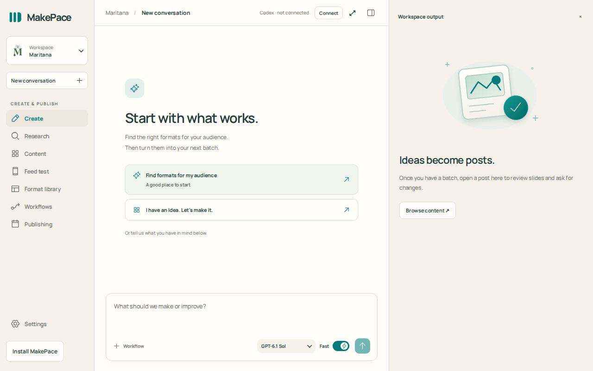
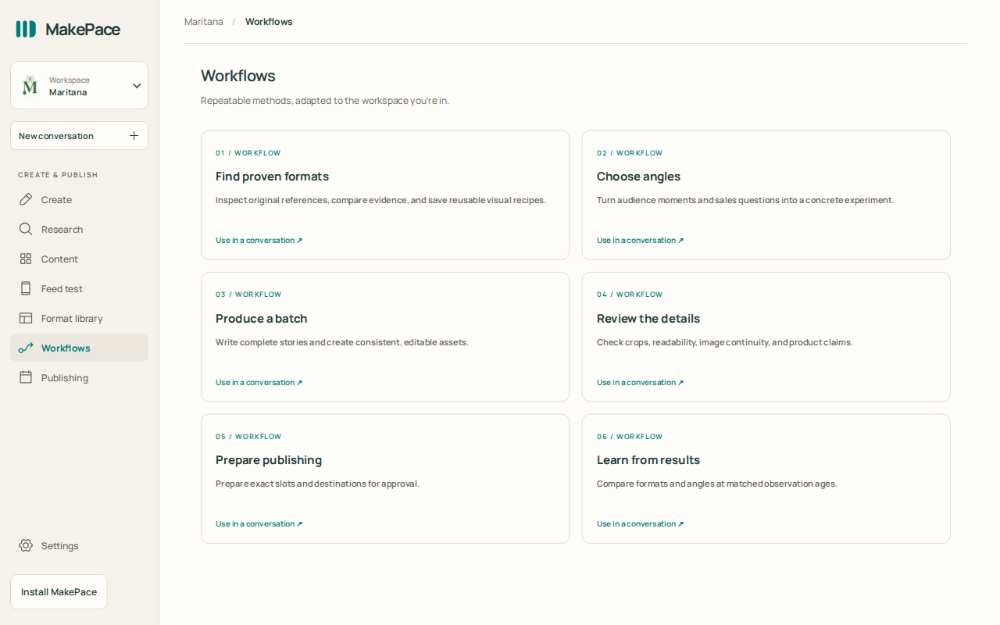
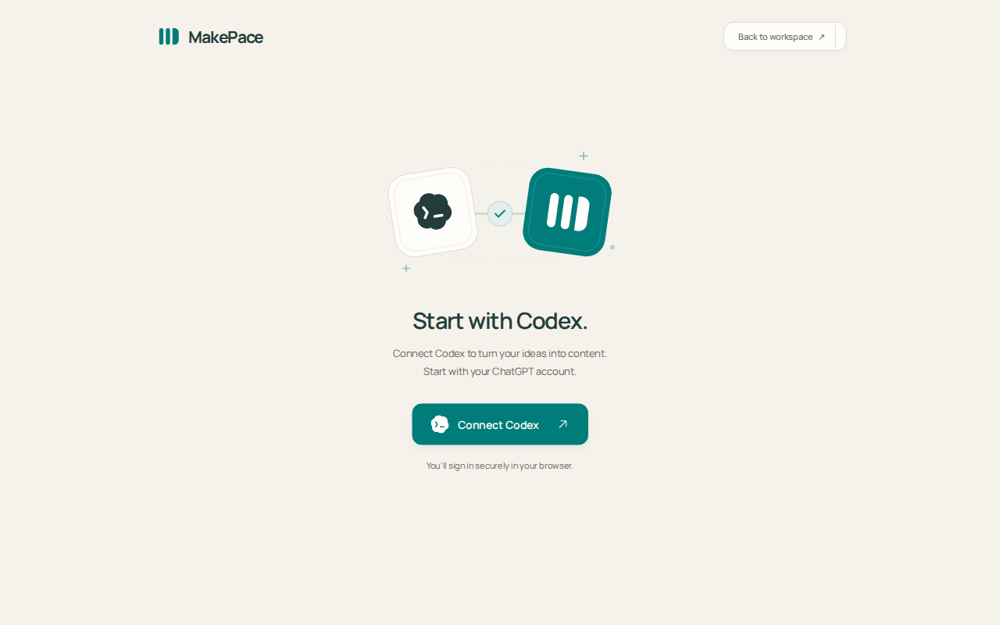

# MakePace

**Your open-source content powerhouse.**

MakePace is a desktop workspace for researching content formats, producing batches,
iterating on previews and scheduling approved posts. It runs locally and connects
to your own Codex account. Optional OneUp and Apify connections handle publishing
and social research.

[Install the alpha](#install) ·
[Website](https://makepace.app) · [Contributing](CONTRIBUTING.md) · [Security](SECURITY.md)



## What you can do

Start with your website and audience, research examples, then turn the useful
patterns into a batch you can review and revise in conversation. Keep research,
formats, content and publishing plans together in one workspace.

1. **Research before creating.** Ask for original posts, source links and visible
   performance evidence. Treat inaccessible sources and missing metrics as gaps,
   not proof that a format works.
2. **Make and refine a batch.** Choose angles, produce content, inspect outputs
   beside the conversation and ask for specific changes.
3. **Review before publishing.** Check the content and proposed schedule, then
   explicitly approve publishing through your connected OneUp account.
4. **Learn for the next batch.** Compare formats and angles using collected results.



These are real captures of the current Studio interface in browser development
mode, showing a workspace before content has been produced. The desktop app uses
the same interface with native connection and credential storage support. They
show the starting experience, not a completed batch or a verified publishing run.

### Bring your own connections



- **Codex:** powers the conversations; requires an eligible account and internet.
- **Apify (optional):** collects social research through your account.
- **OneUp (optional):** schedules approved content to supported connected accounts.

MakePace is free, open-source software. Connected services may charge separately.
Workspace files stay on your computer; prompts and selected content are sent to
the services you use. This alpha still needs real-world workflow testing.

## Install

Download from [GitHub Releases](https://github.com/alonsosolisg/makepace/releases).
The first public version is **0.2.0-alpha.1**. You do not need Node.js or a separate
Codex installation. **Packaged installers are the recommended alpha installation
method; they are currently unsigned and the Mac builds are not notarized.** Read
the first-launch steps below before downloading. Back up important work before
upgrading alpha software. Developers can instead [run from source](#develop).

| Computer               | Download                           | Installation                     |
| ---------------------- | ---------------------------------- | -------------------------------- |
| Windows x64            | `MakePace-…-win-x64.exe`           | Run the installer.               |
| Mac with Apple silicon | `MakePace-…-mac-arm64.dmg`         | Drag MakePace into Applications. |
| Intel Mac              | `MakePace-…-mac-x64.dmg`           | Drag MakePace into Applications. |
| Linux x64              | `MakePace-…-linux-x86_64.AppImage` | Make executable and run.         |

```sh
chmod +x MakePace-0.2.0-alpha.1-linux-x86_64.AppImage
./MakePace-0.2.0-alpha.1-linux-x86_64.AppImage
```

Initial installers are **unsigned and not notarized**. Windows SmartScreen and
macOS Gatekeeper may warn or block them. Verify the download came from this
repository and compare its SHA-256 with `SHA256SUMS.txt` on the same release:
Windows `Get-FileHash <file> -Algorithm SHA256`, macOS `shasum -a 256 <file>`,
Linux `sha256sum <file>`. Checksums verify integrity, not publisher identity.
If organizational policy blocks unsigned apps, use a reviewed source build or
wait for signed releases. A source build is not a guaranteed exception to device
policy. Do not disable system protections globally.

### First launch on macOS

1. Download the DMG matching your Mac: Apple silicon (`arm64`) or Intel (`x64`).
   You can check your chip in **Apple menu → About This Mac**.
2. Open the DMG and drag **MakePace** into **Applications**.
3. Try opening MakePace from Applications.
4. If macOS blocks it because the developer cannot be verified or Apple cannot
   check it, and you have verified the download's source, open **System Settings
   → Privacy & Security** and select **Open Anyway** for MakePace. Confirm the
   prompt and authenticate if asked.

This approves this particular app; it does not turn off Gatekeeper for everything.
See [Apple's official instructions](https://support.apple.com/102445).
If the message says the app is damaged, contains malware, or offers no override,
stop and [report the exact message](https://github.com/alonsosolisg/makepace/issues)
with your macOS version and downloaded filename. Do not treat every launch error
as a signing warning.

### First launch on Windows

Run the `.exe` installer. If SmartScreen displays **Windows protected your PC**,
verify that it is the MakePace installer from this repository, then choose
**More info → Run anyway**, if available. The unsigned installer does not have a
verified publisher identity. Follow the installer and launch MakePace.

If your device policy or Smart App Control blocks it without this option, do not
disable those protections. Use a permitted development environment or wait for a
compatible release. See [Microsoft's SmartScreen guidance](https://learn.microsoft.com/en-us/windows/apps/package-and-deploy/smartscreen-reputation).

## Get started

1. Open MakePace and connect Codex. Sign in through the browser if prompted.
2. Enter your website. Review the offering, audience and social profiles; remove
   incorrect profiles before continuing to create your workspace.
3. Start a conversation to research formats. Review the shortlist before producing a batch.
4. Optionally connect Apify or OneUp in Settings → Connections. Credentials are
   encrypted using your operating system's credential storage.
5. Review your content and exact schedule before approving publishing.

Codex needs an eligible account and internet access. Website screenshots need
installed Chrome or Edge; `CHROME_PATH` can specify the executable. OneUp and
Apify are separate services with their own costs. MakePace runs locally; prompts
and selected content still go to the services you choose. It is not an offline AI model.

## Updates and local files

Choose **MakePace menu → Check for updates**. The app checks GitHub Releases and
opens a newer release for you to download. Stable installations ignore prereleases;
alpha installations include newer alphas and stable versions. There is no silent
installation or background update download. The request sends the app version to
GitHub, not your workspace content.

Quit MakePace before running the new installer. Your workspaces and credentials
live outside the installation directory and are preserved. Back up app data and
content before alpha upgrades; avoid downgrading after modifying data in a newer
version. We use [Semantic Versioning](https://semver.org/); pre-1.0 minor releases
may break behavior and will document migrations.

The MakePace menu opens your workspace and app data folders. Defaults:

- Windows: `%APPDATA%/MakePace`
- macOS: `~/Library/Application Support/MakePace`
- Linux: `$XDG_CONFIG_HOME/MakePace`, normally `~/.config/MakePace`

Metadata and research are under `studio/`; content is under `workspace/`.
Uninstalling does not intentionally erase these directories. Backups contain
private conversations/content. Credentials may need reconnecting on a new computer.

## Develop

Use Node **22.18+ on the 22.x line**, npm and Git. Build desktop installers on
their target OS so the bundled native Codex binary matches.

```sh
git clone https://github.com/alonsosolisg/makepace.git
cd makepace
npm ci
npm run desktop
```

For browser development, `npm run dev` serves the landing at
http://localhost:4885/ and Studio at http://localhost:4885/studio. Browser
development needs a separately available `codex` executable for AI; desktop
uses the bundled provider. Never expose this server publicly.

```sh
npm run check         # Typecheck, lint, formatting and behavior tests
npm run format        # Prettier
npm run build:site    # Static landing → dist/site
npm run desktop:pack  # Unpacked application
npm run desktop:dist  # Installer for the current OS
```

Runtime source is TypeScript: `.mts` for Node ESM, `.cts` for Electron CommonJS,
and `.ts` for browser modules. The build emits disposable files into `dist/app`.
Imports use emitted extensions for NodeNext compatibility. Never edit `dist`.
See [desktop development](desktop/README.md) and [releasing](docs/RELEASING.md).

| Directory               | Purpose                                               |
| ----------------------- | ----------------------------------------------------- |
| `desktop/`              | Electron, encrypted connections, publishing, updates  |
| `scripts/studio/`       | Local server, research harness, workspace UI          |
| `scripts/feed-preview/` | Feed review                                           |
| `landing/`              | Public static website                                 |
| `test/`, `types/`       | Behavior tests and shared contracts                   |
| `infra/downloads/`      | Optional legacy R2 gateway, not needed to run the app |

Private campaign assets, local state and keys are excluded. Connect existing
content explicitly with `MAKEPACE_WORKSPACE_ROOT`; sibling projects are never
imported automatically.

## License

[Apache 2.0](LICENSE). Dependencies retain their own licenses; see
[third-party notices](THIRD_PARTY_NOTICES.md). The license does not grant rights
to imply endorsement using MakePace's name/logo. See [trademarks](TRADEMARKS.md).
